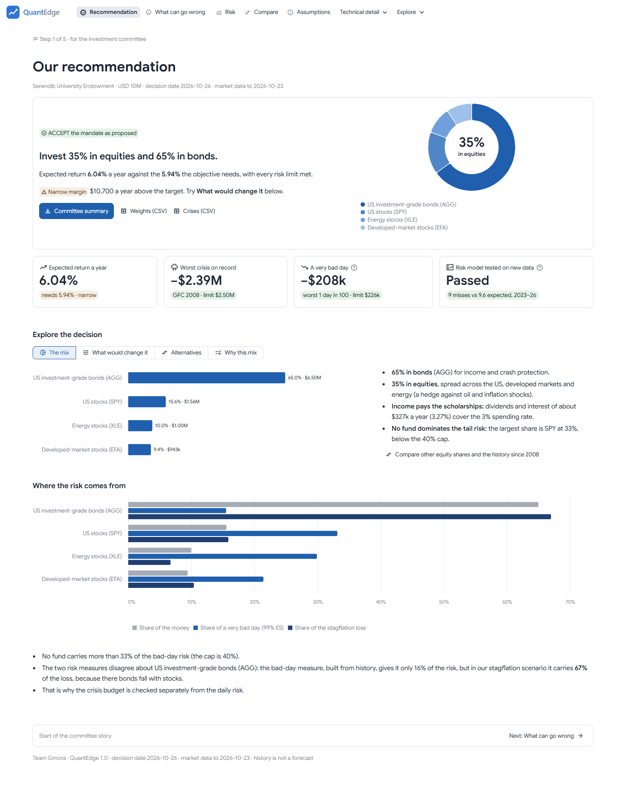
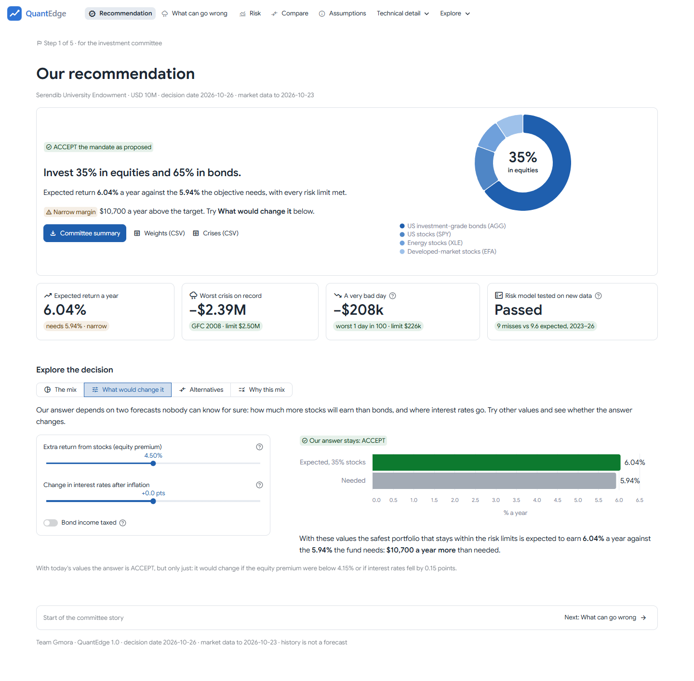
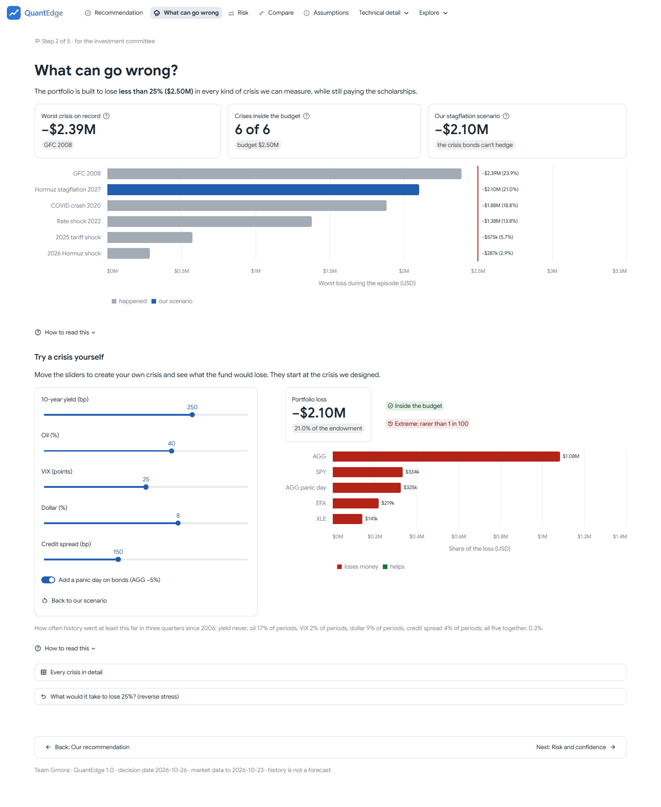
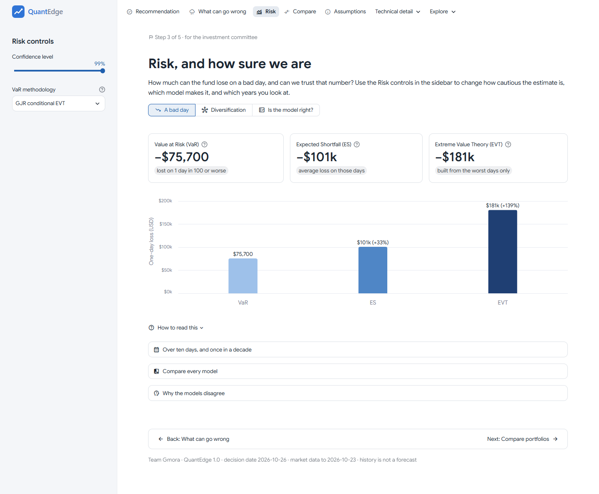
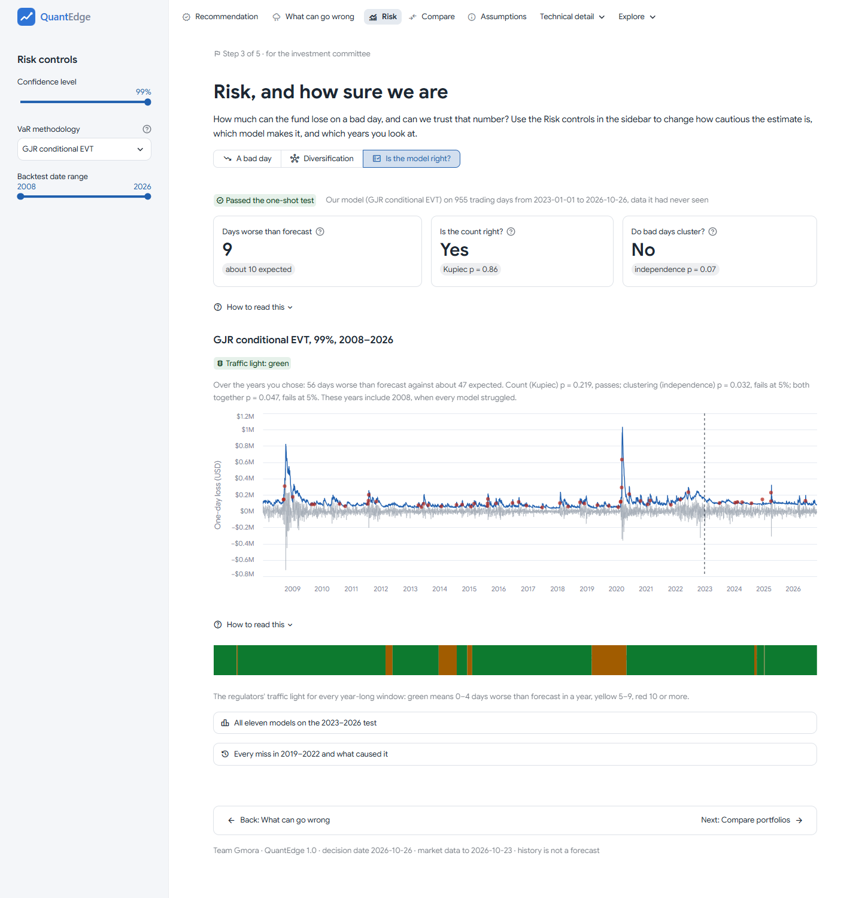
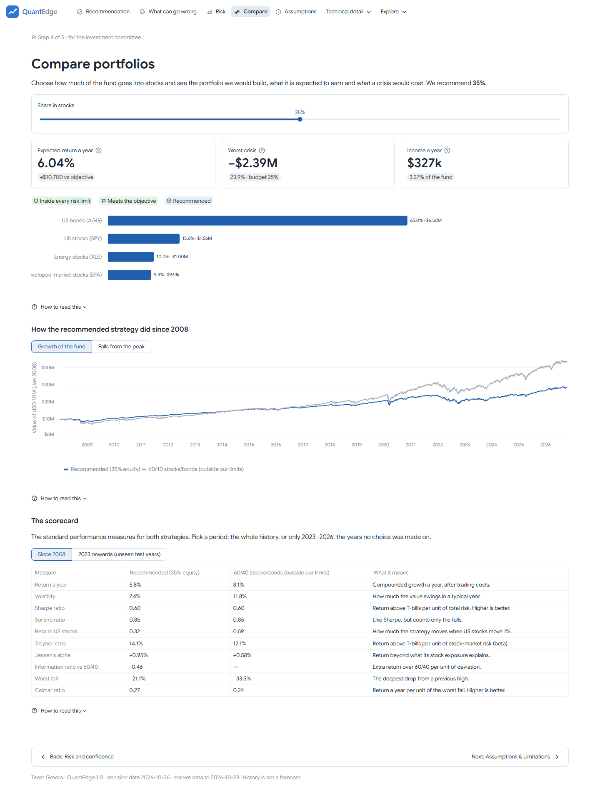
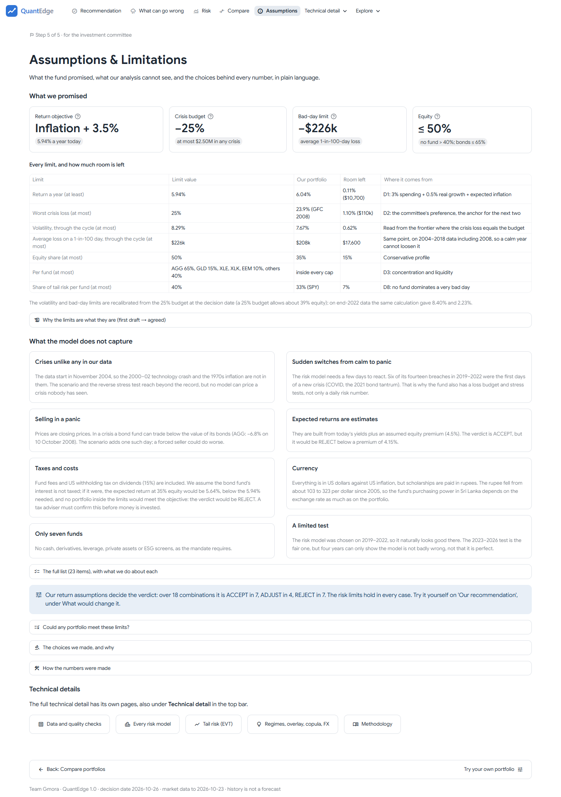
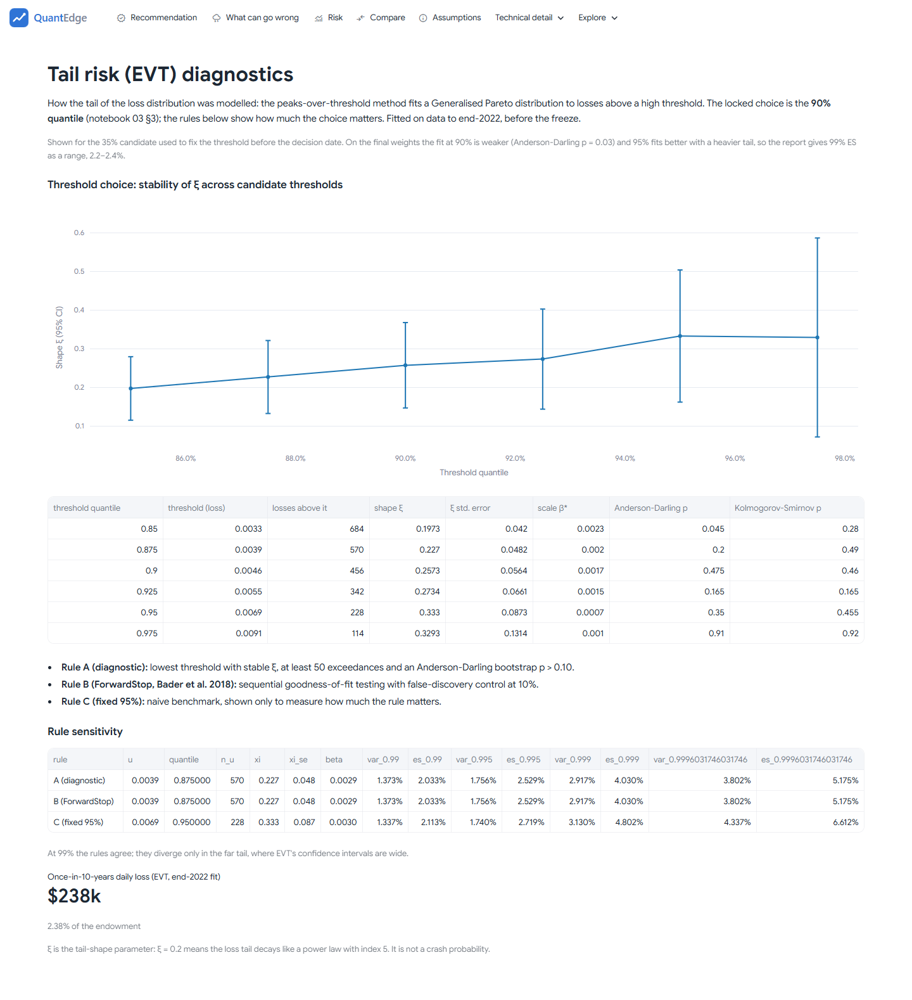
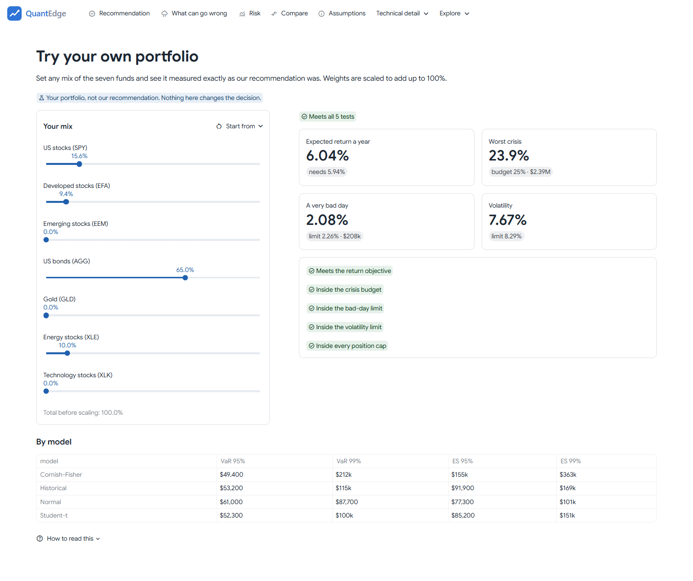
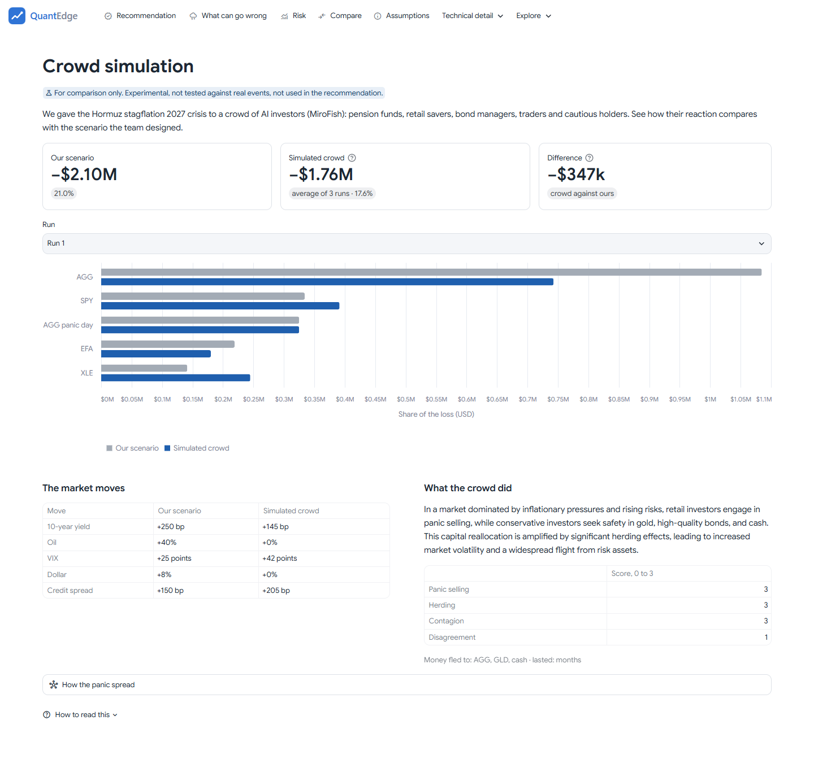

# Risk-Aware Portfolio for the Serendib University Endowment Fund

**Team Gmora** · QuantEdge 1.0 Final Challenge

A Python and Streamlit application that takes seven ETFs from raw market data to a defended investment decision for a conservative USD 10M endowment.

| | |
|---|---|
| **Decision** | ACCEPT the mandate at 35% equity, with a narrow margin |
| **Portfolio** | AGG 65.0%, SPY 15.6%, XLE 10.0%, EFA 9.4% |
| **Return** | 6.04% expected a year against 5.94% required (US inflation + 3.5%) |
| **Worst crisis** | −23.9% (USD 2.39M) in a 2008 replay, inside the 25% budget |
| **Risk model** | GJR conditional EVT: 9 breaches against 9.6 expected on 2023–2026 data it had never seen |



**Live app: <https://quantedge.gmora.dev>**

## Read this first

| Deliverable | Where |
|---|---|
| Technical report and investment memo (13 pages) | [QuantEdge_Technical_Report.pdf](reports/QuantEdge_Technical_Report.pdf) |
| One-page investment committee memo | [Investment_Committee_Memo.pdf](reports/Investment_Committee_Memo.pdf) |
| One-page executive tear sheet | [Executive_Tear_Sheet.pdf](reports/Executive_Tear_Sheet.pdf) |
| Streamlit application | [Live app](https://quantedge.gmora.dev), or [run it with one command](#run-the-app) |
| AI disclosure | [AI_DISCLOSURE.md](AI_DISCLOSURE.md) |
| Every booklet requirement and where it is met | [doc/brief_traceability.md](doc/brief_traceability.md) |

## Run the app

You need Python 3.12 and Git. No API keys, accounts or downloads of market data are needed: the data snapshot and all results are in this repository.

**macOS or Linux**

```bash
git clone https://github.com/Pasidu-Mihiranga/QuantEdge.git
cd QuantEdge
make run
```

**Windows (PowerShell)**

```powershell
git clone https://github.com/Pasidu-Mihiranga/QuantEdge.git
cd QuantEdge
.\make.ps1 run
```

The first run builds a virtual environment and installs the pinned packages, which takes a few minutes. The app then opens at <http://localhost:8501>.

If `streamlit run` reports `No module named 'quantedge'`, a global Python was used. Run `make run` instead, or `.venv/bin/python -m streamlit run app/Home.py`.

## What the app shows

Five pages are written for the investment committee, in plain language, and sit in the top bar in reading order: each one says which step of the story it is and ends with a link to the next. The **Technical detail** menu holds five more pages, and the **Explore** menu lets you try your own portfolio and compare our scenario with a crowd simulation. The app follows your system's light or dark mode.

### Our recommendation

The decision beside the allocation, the four numbers that matter, and a one-page committee summary to download. Four views explore it: the mix and where its risk comes from, what would change the answer, the two alternatives as side-by-side cards, and why this mix. In **What would change it**, move the equity premium, real yield and tax assumptions and watch the verdict respond.



### What can go wrong

Every crisis against one budget, then a scenario builder: set your own shocks to yields, oil, VIX, the dollar and credit, and see the loss by fund and how often history has gone that far. **Back to our scenario** resets the sliders.



### Risk and confidence

The sidebar selects the confidence level (90, 95 or 99%), the VaR methodology and the backtest date range. VaR, ES and EVT sit side by side at the same confidence, so the gap between them is visible.



The **Is the model right?** view has the Kupiec and Christoffersen tests, the Basel traffic light for every year-long window, and every breach with its market cause.



### Compare portfolios

Choose an equity share and see the portfolio, its expected return, crisis loss and income. Below are cumulative return, drawdown, and the KPIs (Sharpe, Sortino, Treynor, Jensen's alpha, Information Ratio, maximum drawdown, Calmar).



### Assumptions & Limitations

Every limit with the room left, every assumption, and 24 limitations with what we do about each.



### Technical detail

In the **Technical detail** menu: data quality flags, all risk models on 2008–2022, EVT threshold diagnostics, and the regime, overlay, copula and FX studies.



### Try your own portfolio

Set any mix of the seven funds and see it measured exactly as the recommendation was: expected return, worst crisis, a very bad day and volatility, each against its limit, with a pass or fail for every test. **Start from** loads the recommendation, either alternative, a 60/40 mix or equal weights. With the sliders untouched, the page gives the recommendation's own numbers.



### Crowd simulation

We gave the same crisis to a crowd of AI investors built with [MiroFish](https://github.com/666ghj/MiroFish): pension funds, retail savers, bond managers, traders and cautious holders react to it and to each other. The page sets their reaction next to the scenario the team designed: the loss, each fund's share, the market moves, and how the panic spread. Across three runs the crowd lost 17.6% on average, against 21.0% for our scenario.

The crowd's answers pick only the direction and strength of each market move. The sizes come from market history, and both sides go through the same stress test, so the comparison is like for like. It is there for comparison: the page reads saved runs and is not used in the recommendation.



## How we reached the decision

**The objective.** 3.0% spending, 0.5% real growth and 10-year breakeven inflation (2.34%) compound to a required return of 5.94% a year.

**The risk limits.** One preference sets them: a maximum 25% loss in any crisis. The frontier point at that loss fixes the volatility limit (8.29%) and the 99% ES limit (2.26%), so the limits cannot contradict one another.

**The portfolio.** We minimise variance at each equity share under position caps (Ledoit-Wolf covariance, 756 days), then score each point with forward returns built from yields on the decision date, after fees, tax and costs.

**The rule.** ACCEPT if a portfolio meets the objective inside every limit; ADJUST THE RISK LIMIT if one would with the budget loosened by at most 5 points; REJECT otherwise. The rule was signed before the final test was run.

| Equity share | Expected return | Crisis loss | Inside limits | Meets objective |
|---|---:|---:|:--:|:--:|
| 30% | 5.81% | 21.9% | yes | no |
| **35%** | **6.04%** | **23.9%** | **yes** | **yes** |
| 40% | 6.12% | 25.4% | no | yes |

### The five technical layers

| Layer | What we did | Main result |
|---|---|---|
| **1. Portfolio theory and KPIs** | Markowitz, CAPM and the standard KPIs, on a walk-forward history after costs | Sharpe 0.60 since 2008, equal to 60/40, with a worst fall of 21.1% against 33.5% |
| **2. Value-at-Risk** | Historical, parametric and Monte Carlo at 95% and 99%, with the reasons they disagree | Close at 95%; USD 88,000–115,000 at 99% |
| **3. Expected Shortfall** | Reported beside VaR; the committee's tail limit is set on it | USD 208,000 through the cycle against a USD 226,000 limit |
| **4. Extreme Value Theory** | Peaks over threshold with six thresholds and three selection rules | Once-in-a-decade daily loss of USD 162,000–384,000; 99% ES is a range, see below |
| **5. Backtesting** | Walk-forward Kupiec, Christoffersen and Basel traffic light, plus the Z2 test for ES | Kupiec p = 0.86, conditional coverage p = 0.19, on the one-shot test |

We also tested regime-conditioned risk, a volatility overlay, a t-copula, macro and FX exposure, and machine-learning challengers. The results are in section 8 of the report. Linear quantile regression passed coverage on the final test but was 5.4% less accurate, so it was not adopted.

### How we kept the test honest

| Period | Dates | Use |
|---|---|---|
| Development | 2004-11-18 to 2018-12-31 | Fitting and design |
| Validation | 2019-01-01 to 2022-12-31 | Choosing the model |
| Final test | 2023-01-01 to 2026-10-26 | One run, after the freeze |

- **Data before the decision:** every forecast for day t uses data up to t−1.
- **Locked test data:** the loader refuses 2023+ data until the git tag `methodology-freeze-v1` exists.
- **Recorded changes:** the [freeze record](doc/decisions/methodology_freeze.md) holds the hashes, and logs later changes with results under both versions.

### What this does not prove

- **The margin is thin.** USD 10,700 a year. ACCEPT is lost if the real yield falls 0.15 points or the equity premium is below 4.15%. It holds in 7 of 18 assumption combinations.
- **Tax can reverse it.** If AGG's interest is taxed at 15%, the base case becomes REJECT, so tax advice is a condition of the recommendation.
- **The test has limited power.** About ten expected breaches can show a model is not detectably wrong, not that it is right.
- **The EVT fit is imperfect.** On the final weights the 90% threshold fails goodness-of-fit at 5%, so we report 99% ES as a range of 2.2–2.4%.
- **The odds over ten years are about even** (49%). The objective is a target, not a promise.

## Reproduce the results

| Command | What it does | Time |
|---|---|---|
| `make test` | Runs the fast test suite | About 1 minute |
| `make pipeline` | Rebuilds the results and reports from the frozen snapshot | About 20 seconds |
| `make pipeline ARGS=--force-backtests` | Also reruns every walk-forward backtest | About 10 minutes |
| `make pdf` | Prints the report, memo and tear sheet (needs Chrome) | About 10 seconds |
| `make notebooks` | Reruns the six analysis notebooks | Several minutes |
| `python scripts/run_swarm.py` | Reruns the crowd simulation (needs MiroFish and an LLM key) | About 7 minutes a run |
| `make data` | Downloads fresh data, replacing the frozen snapshot (not needed to reproduce) | Network |

Windows uses `.\make.ps1 <target>` for each.

- **Data:** adjusted closes from Yahoo Finance and series from FRED, with World Bank data for context. Each raw file is hashed in `data/raw/manifest.json`.
- **Randomness:** every generator takes a seed from `config.yaml`.
- **Independent check:** the notebooks were written separately from the package, and tests reconcile the two: same verdict, weights, frontier, breaches and losses.

## Repository

| Path | Contents |
|---|---|
| `app/` | Streamlit app, reading results only: no model fitting, no downloads |
| `src/quantedge/` | Package: data, portfolio, risk, backtest, stress, decision, reports |
| `notebooks/` | Six analysis notebooks, written separately and reconciled by tests |
| `tests/` | Closed-form, simulation-recovery, textbook and leakage tests |
| `data/raw/`, `data/artifacts/` | Frozen data snapshot and every computed result |
| `reports/` | Report, memo, tear sheet and decision-defence page |
| `doc/decisions/` | Freeze record and exception log |
| `deploy/` | Server deployment (see [doc/deployment.md](doc/deployment.md)) |
| `config.yaml` | Every parameter: dates, limits, model settings, seeds |

Built with Python 3.12, Streamlit, pandas, NumPy, SciPy, statsmodels, arch, cvxpy and Altair. The crowd simulation's runs were produced separately with MiroFish and Gemini; the app only reads the saved results.
